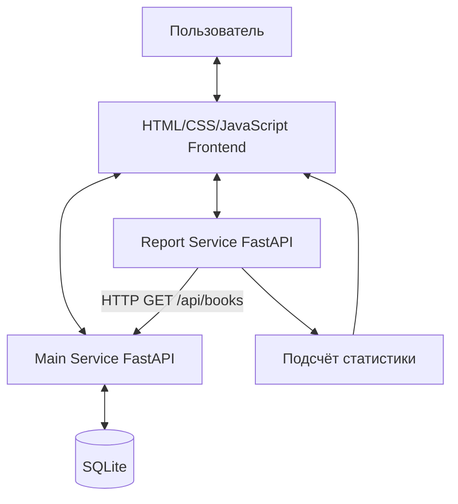

# BooksCatalog

Веб-приложение для ведения персонального каталога прочитанных книг и книг, запланированных к прочтению.

Проект разработан в рамках курсовой работы по дисциплине «Технологии сетевого взаимодействия».

## О проекте

**BooksCatalog** позволяет хранить сведения о книгах и авторах, управлять отметками о прочтении, выполнять поиск и фильтрацию, а также просматривать статистику каталога.

Приложение построено на основе микросервисной архитектуры. Основной сервис отвечает за пользовательский интерфейс, CRUD-операции и работу с SQLite. Отдельный Report Service получает каталог основного сервиса по HTTP в формате JSON и рассчитывает количество прочитанных и непрочитанных книг.

## Основные возможности

- Добавление, просмотр, редактирование и удаление книг.
- Добавление, редактирование и удаление авторов.
- Связь одной книги с одним или несколькими авторами.
- Просмотр отдельной карточки книги.
- Изменение отметки о прочтении.
- Поиск по части названия книги или имени автора без учёта регистра.
- Фильтрация по году издания и статусу прочтения.
- Подсчёт общего количества прочитанных и непрочитанных книг.
- Понятные сообщения об ошибках и проверка входных данных.
- Автоматически сформированная документация Swagger UI для обоих API.

## Используемые технологии

| Компонент | Технология |
|---|---|
| Frontend | HTML, CSS, JavaScript |
| Основной Backend | Python, FastAPI |
| Работа с базой данных | SQLModel, SQLAlchemy |
| База данных | SQLite |
| Report Service | Python, FastAPI |
| HTTP-взаимодействие | HTTP, JSON, HTTPX |
| Документация API | OpenAPI, Swagger UI |
| Контейнеризация | Docker |
| Оркестрация контейнеров | Docker Compose |
| Тестирование | Pytest |

## Архитектура приложения

Приложение состоит из трёх логических компонентов:

1. **Frontend** — интерфейс на HTML, CSS и JavaScript. Он раздаётся основным FastAPI-сервисом и обращается к обоим API.
2. **Main Service** — основной сервер на FastAPI. Выполняет CRUD-операции, поиск, фильтрацию и взаимодействует с SQLite через SQLModel.
3. **Report Service** — отдельный FastAPI-микросервис. По HTTP получает список книг у Main Service и формирует статистику.

В Docker запускаются два контейнера: Main Service вместе с фронтендом и Report Service. База SQLite сохраняется в отдельном Docker volume.

### Схема взаимодействия



## Модель данных

В базе данных используются три таблицы:

- `books` — название, год издания, описание и отметка о прочтении;
- `authors` — имя и краткая биография автора;
- `book_authors` — промежуточная таблица связи многие-ко-многим между книгами и авторами.

## Структура проекта

```text
BooksCatalog/
│
├── main_service/
│   ├── backend/
│   │   ├── __init__.py
│   │   ├── database.py
│   │   ├── errors.py
│   │   ├── main.py
│   │   ├── models.py
│   │   ├── schemas.py
│   │   ├── services.py
│   │   └── routers/
│   │       ├── __init__.py
│   │       ├── authors.py
│   │       └── books.py
│   ├── frontend/
│   │   ├── index.html
│   │   ├── styles.css
│   │   └── app.js
│   ├── __init__.py
│   └── Dockerfile
│
├── report_service/
│   ├── backend/
│   │   ├── __init__.py
│   │   └── main.py
│   ├── __init__.py
│   └── Dockerfile
│
├── .dockerignore
├── .gitignore
├── docker-compose.yml
├── requirements.txt
└── README.md
```

У Report Service нет собственной frontend-папки, поскольку этот микросервис предоставляет только JSON API и Swagger UI.

## Запуск проекта через Docker

### Требования

Перед запуском необходимо установить:

- Docker Desktop;
- Git — при работе с удалённым репозиторием.

### 1. Клонирование репозитория

Открыть PowerShell в папке, где вы хотите сохранить проект, и выполнить:

```powershell
git clone https://github.com/guillxteen/BooksCatalog.git
cd BooksCatalog
```

Репозиторий проекта: [guillxteen/BooksCatalog](https://github.com/guillxteen/BooksCatalog).

Если проект уже скачан в виде архива, распакуйте его и откройте PowerShell в папке с файлом `docker-compose.yml`.

### 2. Сборка и запуск

```powershell
docker compose up -d --build
```

Docker Compose автоматически соберёт и запустит:

- основной сервис вместе с веб-интерфейсом;
- сервис отчётов;
- именованный volume `catalog_data` для базы SQLite.

Проверить состояние контейнеров:

```powershell
docker compose ps
```

После запуска приложение доступно по адресу http://localhost:8000/.

### 3. Остановка

Остановить контейнеры, сохранив базу данных:

```powershell
docker compose down
```

Остановить контейнеры и удалить сохранённую базу:

```powershell
docker compose down -v
```

## Локальный запуск без Docker

### 1. Создание виртуального окружения

```powershell
python -m venv .venv
.\.venv\Scripts\Activate.ps1
python -m pip install -r requirements.txt
```

### 2. Запуск основного сервиса

В первом окне PowerShell:

```powershell
python -m uvicorn main_service.backend.main:app --reload --port 8000
```

### 3. Запуск сервиса отчётов

Во втором окне PowerShell, с активированным тем же виртуальным окружением:

```powershell
python -m uvicorn report_service.backend.main:app --reload --port 8001
```

## Адреса приложения и документации

| Назначение | Адрес |
|---|---|
| Веб-приложение | http://localhost:8000/ |
| Главная Report Service | http://localhost:8001/ — перенаправляет в Swagger |
| Swagger основного сервиса | http://localhost:8000/docs |
| Swagger сервиса отчётов | http://localhost:8001/docs |
| Проверка основного сервиса | http://localhost:8000/health |
| Проверка Report Service | http://localhost:8001/health |

## API основного сервиса

### Книги

| Метод | Endpoint | Назначение |
|---|---|---|
| GET | `/api/books` | Список книг, поиск и фильтрация |
| GET | `/api/books/{book_id}` | Получение карточки книги |
| POST | `/api/books` | Добавление книги |
| PUT | `/api/books/{book_id}` | Полное редактирование книги |
| PATCH | `/api/books/{book_id}/read-status` | Изменение отметки о прочтении |
| DELETE | `/api/books/{book_id}` | Удаление книги |

Параметры `GET /api/books`:

- `search` — часть названия книги или имени автора;
- `year` — год издания;
- `is_read` — статус прочтения: `true` или `false`.

### Авторы

| Метод | Endpoint | Назначение |
|---|---|---|
| GET | `/api/authors` | Получение списка авторов |
| POST | `/api/authors` | Добавление автора |
| PUT | `/api/authors/{author_id}` | Редактирование автора |
| DELETE | `/api/authors/{author_id}` | Удаление автора |

Автор не может быть удалён, пока с ним связана хотя бы одна книга.

При изменении статуса в `PATCH /api/books/{book_id}/read-status` передаётся JSON:

```json
{
  "is_read": true
}
```

## API сервиса отчётов

Report Service не имеет отдельного пользовательского интерфейса. Корневой адрес сервиса
http://localhost:8001/ автоматически перенаправляет пользователя на Swagger UI:
http://localhost:8001/docs.

Если по адресу http://localhost:8001/ отображается ответ `{"detail":"Not Found"}`,
значит используется старая версия контейнера. Пересоберите проект:

```powershell
docker compose down
docker compose up --build
```

| Метод | Endpoint | Назначение |
|---|---|---|
| GET | `/` | Перенаправление в Swagger UI `/docs` |
| GET | `/api/report` | Получение статистики каталога |
| GET | `/health` | Проверка работоспособности сервиса |

Отчёт содержит:

- `total` — общее количество книг;
- `read` — количество прочитанных книг;
- `unread` — количество непрочитанных книг.

Прямые адреса после запуска Docker Compose:

- Swagger UI: http://localhost:8001/docs;
- отчёт в формате JSON: http://localhost:8001/api/report;
- проверка работоспособности: http://localhost:8001/health.
